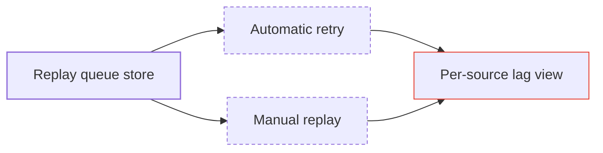

# Relay rebuild: design

Failed relays are retried automatically, and anything still failing lands in a replay queue, so nobody re-sends
by hand after an outage. Lag per source is visible on the status page.

| Piece | Lane | Depends on |
|---|---|---|
| Replay queue store | ingest | none |
| Automatic retry | relay | Replay queue store |
| Manual replay | relay | Replay queue store |
| Per-source lag view | status page | Automatic retry, Manual replay |

## Open items

- [x] Message format stays unchanged
- [ ] Alerting channel (see open questions)
