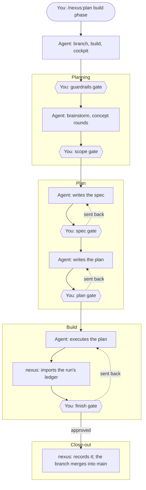
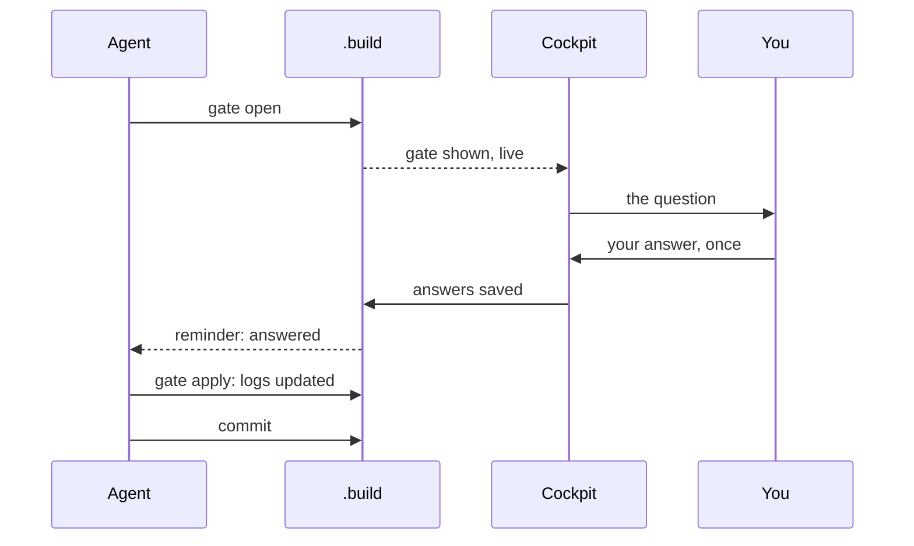
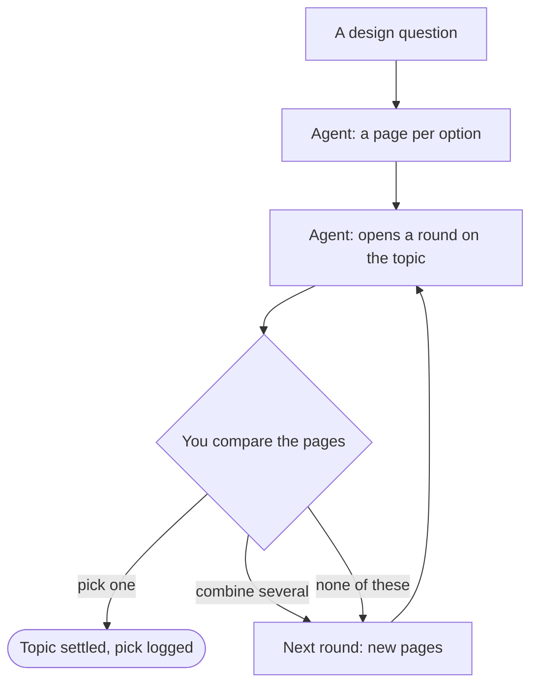
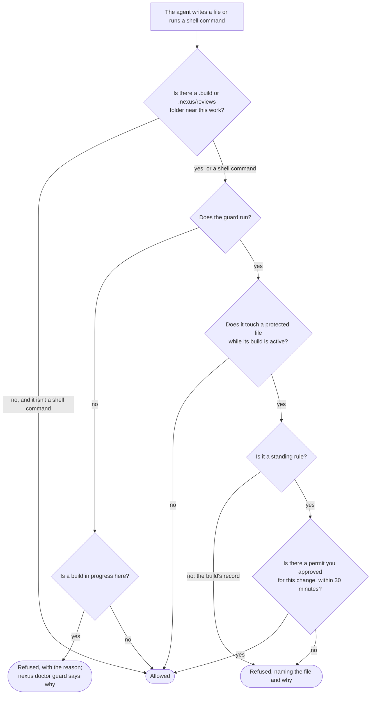
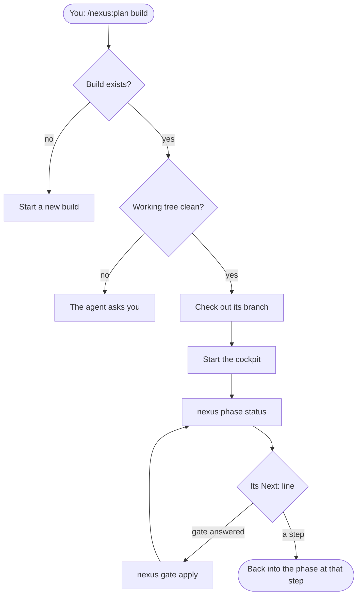

# How a build runs

Five maps of how a build moves in development, each followed by the same story in words. You, the agent and nexus each
have a part: you decide, the agent does the work, nexus keeps the record and the wall.

## A phase, start to merge

You start a phase with `/nexus:plan <build> [phase]`. The agent checks the names you gave, creates the phase's branch,
starts the build (or its next phase) at the planning stage, and opens the cockpit. From there the phase passes five
gates, the six-sided steps on the map, and each is a decision only you make.

At the **guardrails gate** you accept, decline or mark for research each rule the agent proposes for this phase. During
**brainstorming** the agent asks questions, logs what's open and what's settled, and shows you concept rounds when a
design choice is clearer seen than described. The **scope gate** lists the major pieces of the design, with any
conflicts marked on the row they affect; once you've marked them, the phase moves to the plan stage. The agent writes
the spec and asks you to approve it at the **spec gate**, then writes the implementation plan for the **plan gate**.

After the plan is approved the phase moves to the build stage, and the agent executes the plan. The run's rulings and
deferred findings are imported into the logs before it ends. At the **finish gate** you approve the merge: nexus moves
the phase to close-out and the branch fast-forwards into `main`. Sending a gate back, with a note, returns the work to
the step before it, and the agent reopens the gate as `-2`, then `-3`, when it's ready again.

## A gate's round trip

Every decision in a build takes the same path. The agent writes a gate request (the question, its kind, and its rows,
options or the document to approve) and opens it with `nexus gate open`, which checks it before it goes anywhere. The
cockpit shows it in the Gate section within a moment, and the rail marks it as needing you.

You answer it once, in the cockpit. The answer is final for that gate; if something needs another look, the agent opens
a new round of it. Only the cockpit writes answers, and the wall refuses any other attempt, the agent's included.

Before your next prompt reaches the agent, the reminder tells it the gate is answered. The agent runs `nexus gate
apply`, which folds your answers into the logs (decisions, questions, a concept pick) and prints what changed, then
commits the build folder so the record travels with the branch. Guardrail marks are the exception: they stay in the
answers, which is where each guardrail's state is read from.

## Concept rounds

Some questions are easier to answer by looking. When the agent reaches one, it names a topic for the question, writes
each option as a small page, and opens a concept-pick gate: one round. The cockpit shows each page live, one at a
time or two compared side by side or with a swipe, with where each option came from.

If you pick one, the topic is settled and the pick goes into the decision log. If you'd rather combine several, or
none of them is right, your note goes into the next round, which brings new pages on the same topic. Pages never
change once their round opens: the wall refuses edits to them, so what you saw is what was recorded. The Concepts
section keeps every round of a topic, with what was kept and what was dropped.

## The wall

Before each of the agent's writes and shell commands, the harness runs the plugin's PreToolUse hook. A small loader goes
first: where there's no build or review folder anywhere near the work it lets the write through at once, so repos
without nexus don't pay for the wall. Shell commands always go on to the guard, since they can name any path.

The guard works out every file the write or command would change, and refuses it when one is protected and its build
is active. Protected means your standing rules (`CLAUDE.md`, `CLAUDE.local.md`, `AGENTS.md`, `.claude/settings*.json`,
`.claude/rules/`, memory, `.nexus/config.json` and any files that config adds, the docs vault registry `docs/_meta/`,
and the rule files Codex and Antigravity load: `AGENTS.override.md`, `GEMINI.md`, `.agents/rules/`,
`.agents/hooks.json`, `.codex/config.toml` and their global copies) and the build's record: the gate answers,
`build.json`, `plan.json`,
concept pages whose round has opened, and `docs/superpowers/`, so specs and plans land in the build. A review's answers
(`.nexus/reviews/*.answers.json`) are protected the same way, and so is the repo's permanent record that decommission
writes: `docs/governance/decisions.json`, `issues.json` and `builds/`. A build's gate answers stay protected after its
last phase closes, until decommission removes its folder, so the decommission gate is answered only in the cockpit too.
Where part of a path can't be known in advance, such as a variable, the guard judges the parts it can see.

A permit covers only standing rules. When you want one of them changed, the agent opens an approve gate with a
**permit** naming the file and the change. Once you approve, the agent has 30 minutes to make that change, then applies
the gate, which closes the permit. The build's own record never takes a permit: it changes only through nexus commands
and your answers in the cockpit. Nor does the repo's permanent record: it changes only at decommission.

If the guard itself can't run, for example after a broken plugin update, writes are refused where a build is in
progress, to a review's answers or index, and for shell commands while a review is open; finished or unrelated repos
keep working. `nexus doctor guard` says what's wrong.

## Picking a phase back up

A session can end at any point in a phase: between gates, or while a gate waits for you. To pick it back up, run
`/nexus:plan <build>` again. The agent sees the build exists, makes sure the working tree is clean (and asks you if it
isn't), checks out the build's branch and starts the cockpit.

Then it runs `nexus phase status`, which lists the phase's gates and their state and ends with one `Next:` line: a
gate to answer, a gate to apply, or the `/nexus:plan` step to continue at. The agent follows it, applying any answered
gates and running the status again, until the line points into a step. Before brainstorming again, the agent reads the
decisions and questions already logged, so you aren't asked the same things twice. You can run `nexus phase status`
yourself at any time to see where a build stands.
