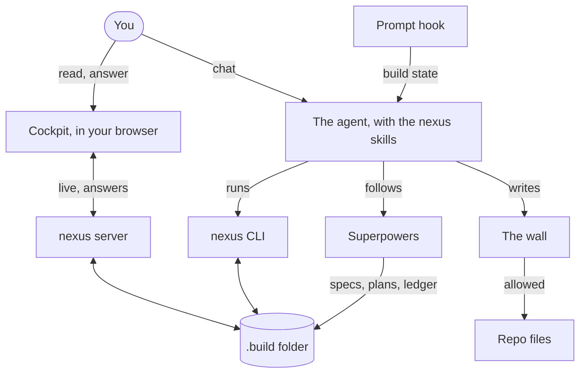

# Overview

## What nexus is

nexus is a temporary cockpit for one piece of work, called a build. While the agent works on it, nexus keeps the build's
record in the repo, under `.build/<build>/`: the guardrails it holds to, the decisions made, the open questions, the
issues found, the changes made after review, and the specs and plans it follows. You read that record in the cockpit,
a page in your browser, and you make the build's decisions there, at gates.

The point is that the decisions and rules of a piece of work stay visible and reviewable, rather than living in a chat
that scrolls away. The agent does the work; you decide at the gates; nexus keeps the record, and the wall that stops the
record and your standing rules from being changed behind your back.

A build runs in phases. Each phase goes from planning to a plan, then to building, and ends in close-out, once you
approve its finish; its work stays on its branch until the build is decommissioned. The same build can carry on with
another phase, branching from the last one and keeping everything recorded so far.

## The parts

**The build folder.** `.build/<build>/` holds everything nexus knows about a build: `build.json` (its phase, stage and
branch), the logs, the gates and your answers, the documents (specs, plans, audits, reports, notes) and the concept
pages. It's committed with the work, so the record travels with the branch.

**Phases and stages.** A phase is one stretch of work with its own branch. Within a phase the stage says where the work
is: planning (guardrails, brainstorming and scope), plan (the spec and the implementation plan), build (execution) and
close-out (finished: you approved it at the finish gate; its branch holds the work until decommission).

**Gates.** A gate is a decision the agent needs from you. The agent opens it, the cockpit shows it, and you answer it
once. There are four kinds: approve (approve or send back, with a note), mark-list (mark each row: accept, decline,
research), concept-pick (pick one of several designs, combine some, or say none of these) and review (keep, adjust or
remove each of the Repo view's items). Five standard gates mark the steps of every phase: guardrails, scope, spec,
plan and finish.

**Guardrails and the wall.** A guardrail is a rule this build holds to, such as "add no new runtime dependencies".
The agent or you propose one; it applies only once you accept it at a gate. The wall is a check that runs before each of
the agent's writes and refuses changes to protected files while a build is active. Your standing rules are protected:
`CLAUDE.md`, `CLAUDE.local.md`, `AGENTS.md`, `.claude/settings*.json`, `.claude/rules/`, memory, `.nexus/config.json`,
the docs vault registry `docs/_meta/`, and the rule files Codex and Antigravity load (`AGENTS.override.md`,
`GEMINI.md`, `.agents/rules/`, `.agents/rules.json`, the older rule folders `.agent/rules/`, `_agents/rules/` and
`_agent/rules/`, `.agents/hooks.json`, `.codex/config.toml` and their global copies). So is the build's
own record: your gate answers,
`build.json`, `plan.json` and concept pages already shown to you; and `docs/superpowers/`, so specs and plans land in
the build instead. So are a review's answers and the repo's permanent record (`docs/governance/decisions.json`,
`issues.json`, `builds/`).
Your gate answers stay protected until decommission removes the build.
A permit covers only standing rules: when you want one changed, the agent asks at a gate with a permit, and edits only
after you approve. The rest changes only through nexus commands and your answers in the cockpit.

**The cockpit.** `nexus serve` starts it on this machine only. Its sections are Gate (what's waiting for you), Plan (the
approved plan and each task's progress), Phases (the phases the build plans to run, in order), Logs (decisions,
issues, changes, questions, guardrails), Concepts (every concept round and what was picked), Documents, and this
Guidance. It updates live as the build changes.

**Concept rounds.** When a question is clearer shown than told, such as how a page should look, the agent writes each
option as a small page and opens a concept-pick gate. You look at the pages in the cockpit, compare them, and pick one.
If none is right, or you want parts of several, the next round brings new pages.

**The logs.** Four logs keep the build's record: decisions (accepted, declined), questions (exploring, research,
answered), issues (open, addressed, closed) and changes (applied, reverted). Your gate answers feed them, and so does
the agent as the work goes.

## How the parts talk

You work in two places: the chat with the agent, and the cockpit. The agent changes the build only through the nexus
CLI, which checks every change against the build's formats. The cockpit's server reads the same folder and shows each
change as it lands; your answers go back through the server into the build, and nowhere else.

Planning itself is Superpowers' work: brainstorming, writing the spec and plan, and executing it. `/nexus:plan` wires
nexus around it, so the spec and plan land in the build's documents, each step ends at a gate, and execution's
rulings and deferred findings reach the logs. Three hooks keep the agent on track between prompts: the prompt hook
(UserPromptSubmit) tells the agent the build's state before each of your prompts, the wall (PreToolUse) stands in
front of every write, and the docs check (PostToolUse) checks each note the agent writes in a repo's `docs/` vault.

## Glossary

- **Agent:** the AI model working in your session, which writes the build's files and asks you at gates.
- **Harness:** the tool the agent runs in, which loads nexus's skills and runs its hooks; Claude Code today.
- **Build:** a piece of work nexus keeps the record of, in `.build/<build>/`, with its own branch per phase.
- **Phase:** one stretch of a build's work, from planning to close-out. A build can have several, one after another;
  the Phases tab lists the ones planned, numbered in order, and renumbers them when one is split or dropped.
- **Stage:** where a phase is: planning, plan, build or close-out.
- **Gate:** a decision the agent needs from you, answered once in the cockpit: approve, mark-list, concept-pick or
  review.
- **Step:** one of the five points every phase passes, each with its gate: guardrails, scope, spec, plan and finish.
  A build has one more after its last phase: decommission.
- **Guardrail:** a rule the build holds to, in force once you accept it at a gate.
- **Permit:** your approval, at a gate, for one change to a standing rule file; it lasts 30 minutes and covers that
  file. A review row you mark Adjust or Remove is a permit for its file too.
- **Round:** one concept-pick gate. A topic may take several rounds before it's settled.
- **Topic:** the question a concept round settles, such as how the status page should look; its rounds share it.
- **Ledger:** the progress file an execution run keeps; `nexus ledger import` copies its rulings and findings into the
  logs and keeps its task record.
- **Close-out:** the last stage of a phase, reached once you approve the finish gate; the wall comes down (all but your
  gate answers) and the work stays on its branch. Only `nexus phase start` leaves it.
- **Decommission:** moving a finished build's record into the repo's `docs/` vault, in one commit, then landing the
  build on `main`. You answer one gate
  on the final report: mark which guardrails become repo rules, or approve the report when there are none. The
  decisions it names, the open issues and the build's documents move with it.
- **Review:** a gate on the Repo view's items (memory, rules, instruction files): keep, adjust or remove each one.
