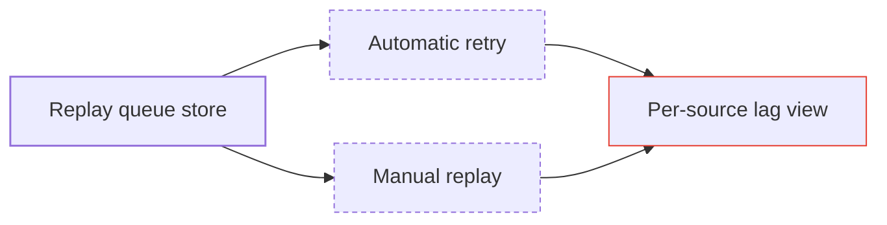

# Writing for the cockpit

Documents in `documents/` and `notes/` are read in the cockpit, beside the work. Write them to be seen.

## Practices

- **Lead with a visual wherever the content has structure.** Prose covers only what the diagram can't:
  - flows and dependencies: a Mermaid flowchart;
  - interactions: a sequence diagram;
  - lifecycles: a state diagram;
  - schedules: a timeline or Gantt chart;
  - comparisons and inventories: a table.
- **The first screen is the summary.** The purpose in two sentences, then the key diagram, then the detail.
- **Use the cockpit's state grammar in diagrams:** `done` solid, `pending` dashed, `needs` red for what waits on
  the user. Use right-angle lines where the layout allows.
- **Show state rather than narrating it.** Counts and statuses go in tables or task lists, and reports and audits
  open with a table of results.
- **Readable names everywhere,** including diagram nodes. No coded IDs.

## Where documents go

| Folder | For |
|---|---|
| `documents/specs/` | designs to review (often attached to an approve gate) |
| `documents/plans/` | plans and task breakdowns |
| `documents/audits/` | reviews of finished pieces |
| `documents/reports/` | progress and close-out reports |
| `notes/` | the user's steering notes and the agent's working notes |

## Diagram example

Keep the `classDef` lines: the cockpit restyles the classes to its theme, and other viewers (GitHub, Obsidian)
still render something sensible.
