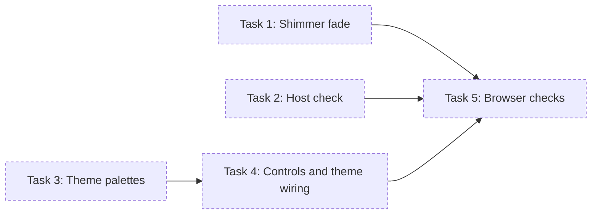

# Replay and Dark Theme Implementation Plan

> **For agentic workers:** REQUIRED SUB-SKILL: Use superpowers:subagent-driven-development (recommended) or superpowers:executing-plans to implement this plan task-by-task. Steps use checkbox (`- [ ]`) syntax for tracking.

**Goal:** Add Replay (one Skip/Replay action button), a Night ink dark theme with an OS-plus-toggle switch, and three
phase-1 fixes (focus after Skip, the shimmer fade, the dev server's Host check).

**Architecture:** Both palettes live in `styles.css` under the same five CSS variables, selected by the OS setting
or a `data-theme` attribute on `<html>`. `main.js` gains the action-button cycle and the theme toggle, re-reading
the palette on every theme change. `motion.js` and `serve.mjs` each get a small, unit-tested change.

**Tech Stack:** HTML, CSS, browser ES modules, Canvas 2D; Node 24 (`node:test`, `node:http`); no npm dependencies.

**Spec:** `.build/splash-test/documents/specs/phase-2/replay-theme-design.md` (approved at gate `spec-phase-2`).



## Global Constraints

- Work on the existing branch `build/splash-test-phase-2` in this checkout (`C:/work/nexus-test`).
  `.build/` lives here, so don't move execution into a separate worktree. Never push.
- Node 24.2 or later (installed: v24.18.0). No npm dependencies; `package.json` stays `{ "private": true, "type": "module" }`.
- Don't touch `CLAUDE.md`, `.claude/`, `.nexus/`, or anything under `.build/` except where a task names a path there.
- Accepted guardrails (paste `nexus guardrail list --accepted` into every dispatch brief):
  - The page loads nothing from the network at runtime: every script, font and asset ships with the page.
  - The whole animation finishes in under four seconds, and a visible Skip is available while it plays.
  - When the viewer prefers reduced motion, the page shows the end state straight away with no animation.
  - Canvas or SVG for the points, whether the chart animates in, and the colour palette are put to the user, not
    decided by Claude.
  - Phase 1 builds only the splash; the replay button and the second colour theme wait for a later phase.
  - Phase 2 adds the replay button and the second colour theme; anything beyond those goes through the scope gate first.
  - Every play, including Replay, shows Skip while it runs, ends on the same end state, and never runs two animations at once.
  - Under reduced motion, Replay shows the end state straight away without animating.
  - Every theme colour reaches the renderer as a 6-digit hex value.
  - The second theme's palette, how the viewer switches theme, and Replay's look and placement are put to the user,
    not decided by Claude.
- Paper: `--bg #F6F3EC`, `--points #3A3A3A`, `--n-mark #1E1E1E`, `--chart-line #2F6FDB`, `--control #5A5A5A`.
- Night ink: `--bg #0E1726`, `--points #9FE3F0`, `--n-mark #E8F6FA`, `--chart-line #F2B544`, `--control #C9D4E0`.
- Action button labels: `Skip`, `Replay`. Toggle labels: `Dark` (while Paper shows), `Light` (while Night ink shows);
  aria-labels "Switch to dark theme" and "Switch to light theme".
- Hold alpha: `1 − 0.125 × sin(πp) × (1 − sin(2π(p + φ)))`.
- Host check: 403 unless `Host` is exactly `127.0.0.1:<port>` or `localhost:<port>`; a missing Host also gets 403.

## Review Focus

1. **Theme switched mid-animation.** A viewer who presses the toggle while points are moving expects the colours to
   change on the next frame without a restart. Task 5 checks it with a screenshot during the run and at the end.
2. **OS theme changing while the page is open.** With no override the page follows the OS setting. After the toggle
   has been used, the override holds. Task 5 flips the emulated colour scheme after load, both with and without an
   override.
3. **Calling `play()` while a run is going.** This must leave exactly one pending animation frame, never two loops.
   Task 5 calls `play()` three times in a row from the page and counts pending frames.
4. **The no-canvas fallback.** The toggle must still show and switch the theme, and the action button must stay
   hidden. Task 5 stubs `getContext` to return null.
5. **A Host header on the right name but the wrong port** (`localhost:1`) must get 403 as well. Task 2 pins it.

No other additions beyond the spec: the Task 5 browser checks above extend the spec's browser-check list to cover
the Review Focus items.

---

### Task 1: Shimmer fade

**Files:**
- Modify: `src/motion.js` (the hold `alpha` line, currently `alpha: 0.875 + 0.125 * Math.sin(2 * Math.PI * (p + pt.shimmer)),`)
- Test: `test/motion.test.mjs` (append one test)

**Interfaces:**
- Consumes: nothing new. `frameAt(t, scene)` keeps its shape: `{ points: [{ x, y, alpha }], ink, line }`.
- Produces: the same `frameAt`, with the new hold alpha.

- [ ] **Step 1: Write the failing test**

Append to `test/motion.test.mjs`:

```js
test('the hold shimmer fades in and out, with no opacity jump at either end', () => {
  for (const p of frameAt(1300, scene).points) assert.equal(p.alpha, 1);
  for (const p of frameAt(1899.9, scene).points) assert.ok(p.alpha >= 0.999, `alpha ${p.alpha} at 1899.9 ms`);
  for (let t = 1300; t < 1900; t += 10) {
    for (const p of frameAt(t, scene).points) {
      assert.ok(p.alpha >= 0.75 - 1e-9 && p.alpha <= 1 + 1e-9, `alpha ${p.alpha} at ${t} ms`);
    }
  }
});
```

- [ ] **Step 2: Run the test to verify it fails**

Run: `node --test test/motion.test.mjs`
Expected: FAIL on the new test. At 1300 ms the alpha is currently `0.875 + 0.125 × sin(2πφ)`, not 1.

- [ ] **Step 3: Change the hold alpha**

In `src/motion.js`, replace:

```js
      alpha: 0.875 + 0.125 * Math.sin(2 * Math.PI * (p + pt.shimmer)),
```

with:

```js
      alpha: 1 - 0.125 * Math.sin(Math.PI * p) * (1 - Math.sin(2 * Math.PI * (p + pt.shimmer))),
```

- [ ] **Step 4: Run the tests to verify they pass**

Run: `node --test test/motion.test.mjs`
Expected: PASS, 10 tests. The existing "the hold shimmers in opacity only" test still passes, since mid-hold alpha
still dips below 0.99.

- [ ] **Step 5: Commit**

```bash
git add src/motion.js test/motion.test.mjs
git commit -m "splash: fade the hold shimmer in and out"
```

---

### Task 2: Host check

**Files:**
- Modify: `serve.mjs` (`createStaticServer`)
- Test: `test/serve.test.mjs` (replace the `get` helper; append three tests)

**Interfaces:**
- Consumes: nothing new.
- Produces: the same `createStaticServer(root?) => http.Server`. Requests now need a loopback `Host` header.

- [ ] **Step 1: Write the failing tests**

In `test/serve.test.mjs`, replace the whole `get` function, including its comment, with this version. It accepts
extra headers and can omit `Host`:

```js
// node:http sends the path exactly as given, so traversal attempts reach the server unnormalised.
function get(path, method = 'GET', { headers = {}, setHost = true } = {}) {
  return new Promise((resolve, reject) => {
    const req = request({ host: '127.0.0.1', port, path, method, headers, setHost }, (res) => {
      let body = '';
      res.setEncoding('utf8');
      res.on('data', (chunk) => { body += chunk; });
      res.on('end', () => resolve({ status: res.statusCode, type: res.headers['content-type'] ?? '', body }));
    });
    req.on('error', reject);
    req.end();
  });
}
```

Append:

```js
test('a foreign Host is refused before any file is read', async () => {
  for (const host of ['evil.example', `evil.example:${port}`, 'localhost:1']) {
    assert.equal((await get('/', 'GET', { headers: { Host: host } })).status, 403, host);
  }
});

test('a request with no Host header is refused', async () => {
  assert.equal((await get('/', 'GET', { setHost: false })).status, 403);
});

test('localhost and 127.0.0.1 on the server port are both allowed', async () => {
  assert.equal((await get('/', 'GET', { headers: { Host: `localhost:${port}` } })).status, 200);
  assert.equal((await get('/', 'GET', { headers: { Host: `127.0.0.1:${port}` } })).status, 200);
});
```

- [ ] **Step 2: Run the tests to verify they fail**

Run: `node --test test/serve.test.mjs`
Expected: FAIL. The foreign Host gets 200, and the missing Host gets 400 from Node's default `requireHostHeader`.

- [ ] **Step 3: Add the check**

In `serve.mjs`, change `return createServer(async (req, res) => {` to:

```js
  // requireHostHeader is off so a missing Host reaches the check below and gets 403, not Node's own 400.
  return createServer({ requireHostHeader: false }, async (req, res) => {
    const port = req.socket.localPort;
    if (req.headers.host !== `127.0.0.1:${port}` && req.headers.host !== `localhost:${port}`) {
      send(res, 403, 'Forbidden');
      return;
    }
```

The existing method check follows unchanged.

- [ ] **Step 4: Run the tests to verify they pass**

Run: `node --test test/serve.test.mjs`
Expected: PASS, 10 tests.

- [ ] **Step 5: Commit**

```bash
git add serve.mjs test/serve.test.mjs
git commit -m "splash: refuse non-loopback Host headers in the dev server"
```

---

### Task 3: Theme palettes

**Files:**
- Modify: `styles.css` (the `:root` block and the two `var(--skip)` uses)
- Create: `test/theme.test.mjs`

**Interfaces:**
- Consumes: nothing.
- Produces: the CSS variables `--bg`, `--points`, `--n-mark`, `--chart-line` and `--control`, in Paper on `:root`
  and in Night ink under the OS dark setting or `:root[data-theme="dark"]`. `--skip` no longer exists. Task 4
  renames `.skip` to `.control`; this task leaves the `.skip` rules in place, now using `var(--control)`.

- [ ] **Step 1: Write the failing test**

Create `test/theme.test.mjs`:

```js
import test from 'node:test';
import assert from 'node:assert/strict';
import { readFile } from 'node:fs/promises';
import { dirname, join } from 'node:path';
import { fileURLToPath } from 'node:url';

const CSS = await readFile(join(dirname(fileURLToPath(import.meta.url)), '..', 'styles.css'), 'utf8');

const PAPER = {
  '--bg': '#F6F3EC', '--points': '#3A3A3A', '--n-mark': '#1E1E1E', '--chart-line': '#2F6FDB', '--control': '#5A5A5A',
};
const NIGHT_INK = {
  '--bg': '#0E1726', '--points': '#9FE3F0', '--n-mark': '#E8F6FA', '--chart-line': '#F2B544', '--control': '#C9D4E0',
};

function variablesIn(pattern) {
  const match = CSS.match(pattern);
  assert.ok(match, `styles.css has no block matching ${pattern}`);
  return Object.fromEntries(
    [...match[1].matchAll(/(--[\w-]+)\s*:\s*([^;]+);/g)].map(([, name, value]) => [name, value.trim()]),
  );
}

const paper = variablesIn(/^:root\s*\{([^}]*)\}/m);
const systemDark = variablesIn(
  /@media\s*\(prefers-color-scheme:\s*dark\)\s*\{\s*:root:not\(\[data-theme="light"\]\)\s*\{([^}]*)\}/,
);
const overrideDark = variablesIn(/:root\[data-theme="dark"\]\s*\{([^}]*)\}/);

test('Paper defines exactly the five palette variables with the chosen values', () => {
  assert.deepEqual(paper, PAPER);
});

test('Night ink under the OS dark setting has the chosen values', () => {
  assert.deepEqual(systemDark, NIGHT_INK);
});

test('Night ink under data-theme="dark" matches the OS-dark block', () => {
  assert.deepEqual(overrideDark, NIGHT_INK);
});

test('every palette value is 6-digit hex', () => {
  for (const value of [...Object.values(paper), ...Object.values(systemDark), ...Object.values(overrideDark)]) {
    assert.match(value, /^#[0-9A-Fa-f]{6}$/);
  }
});

test('nothing still refers to the old --skip variable', () => {
  assert.doesNotMatch(CSS, /--skip\b/);
});
```

- [ ] **Step 2: Run the test to verify it fails**

Run: `node --test test/theme.test.mjs`
Expected: FAIL. There is no OS-dark block yet, so `variablesIn` asserts at load and the file reports a failure.

- [ ] **Step 3: Write the palettes**

In `styles.css`, replace the existing `:root { … }` block (the first 7 lines) with:

```css
:root {
  color-scheme: light;
  --bg: #F6F3EC;
  --points: #3A3A3A;
  --n-mark: #1E1E1E;
  --chart-line: #2F6FDB;
  --control: #5A5A5A;
}

@media (prefers-color-scheme: dark) {
  :root:not([data-theme="light"]) {
    color-scheme: dark;
    --bg: #0E1726;
    --points: #9FE3F0;
    --n-mark: #E8F6FA;
    --chart-line: #F2B544;
    --control: #C9D4E0;
  }
}

:root[data-theme="dark"] {
  color-scheme: dark;
  --bg: #0E1726;
  --points: #9FE3F0;
  --n-mark: #E8F6FA;
  --chart-line: #F2B544;
  --control: #C9D4E0;
}
```

Then, in the `.skip` rule, change `color: var(--skip);` to `color: var(--control);` and
`border: 1px solid var(--skip);` to `border: 1px solid var(--control);`.

- [ ] **Step 4: Run the tests to verify they pass**

Run: `node --test`
Expected: PASS, every test file including the 5 new theme tests.

- [ ] **Step 5: Commit**

```bash
git add styles.css test/theme.test.mjs
git commit -m "splash: add the Night ink theme palette"
```

---

### Task 4: Controls and theme wiring

**Files:**
- Modify: `index.html` (the Skip button line)
- Modify: `styles.css` (the `.skip`, `.skip[hidden]` and `.skip:focus-visible` rules)
- Modify: `src/main.js` (whole file)

**Interfaces:**
- Consumes: `TOTAL` from `src/timeline.js`; `createScene(width, height)` and `frameAt(t, scene)` from
  `src/motion.js`; `drawFrame(ctx, frame, scene, palette)` from `src/render.js`, where `palette` is
  `{ bg, points, nMark, chartLine }`. The CSS variables from Task 3.
- Produces: `play()` and `showEnd()` exported from `src/main.js`, plus the page's `button.control.action` and
  `button.control.theme-toggle`. Task 5's checks select those classes and call `play()` through a dynamic import.

- [ ] **Step 1: Replace the button in the page**

In `index.html`, replace:

```html
  <button type="button" class="skip" hidden>Skip</button>
```

with:

```html
  <button type="button" class="control action" hidden>Skip</button>
  <button type="button" class="control theme-toggle" hidden>Dark</button>
```

- [ ] **Step 2: Replace the button styles**

In `styles.css`, replace the three rules `.skip { … }`, `.skip[hidden] { … }` and `.skip:focus-visible { … }` with:

```css
.control {
  position: fixed;
  bottom: 16px;
  min-height: 44px;
  padding: 0 18px;
  font: 15px/1 system-ui, -apple-system, "Segoe UI", Roboto, sans-serif;
  color: var(--control);
  background: transparent;
  border: 1px solid var(--control);
  border-radius: 4px;
  cursor: pointer;
}

.action {
  right: 16px;
}

.theme-toggle {
  left: 16px;
}

.control[hidden] {
  display: none;
}

.control:focus-visible {
  outline: 2px solid var(--chart-line);
  outline-offset: 2px;
}
```

- [ ] **Step 3: Rewrite main**

Replace the whole of `src/main.js` with:

```js
// Wires the splash into the page: canvas sizing, the animation loop, the Skip/Replay action button, the theme
// toggle, reduced motion, resize and the fallback.

import { TOTAL } from './timeline.js';
import { createScene, frameAt } from './motion.js';
import { drawFrame } from './render.js';

const MAX_DPR = 2;

const root = document.documentElement;
const canvas = document.querySelector('canvas');
const action = document.querySelector('.action');
const toggle = document.querySelector('.theme-toggle');
const ctx = canvas.getContext('2d');
const reducedMotion = window.matchMedia('(prefers-reduced-motion: reduce)');
const darkScheme = window.matchMedia('(prefers-color-scheme: dark)');

let scene = null;
let palette = null;
let frameId = 0;
let startTime = 0;
let ended = false;

function readPalette() {
  const style = getComputedStyle(root);
  const value = (name) => style.getPropertyValue(name).trim();
  return { bg: value('--bg'), points: value('--points'), nMark: value('--n-mark'), chartLine: value('--chart-line') };
}

// Sized from the canvas's own box, so mobile toolbars showing or hiding never stretch the drawing.
function fitCanvas() {
  const { width, height } = canvas.getBoundingClientRect();
  const dpr = Math.min(window.devicePixelRatio || 1, MAX_DPR);
  canvas.width = Math.round(width * dpr);
  canvas.height = Math.round(height * dpr);
  ctx.setTransform(dpr, 0, 0, dpr, 0, 0);
  scene = createScene(width, height);
}

function draw(t) {
  drawFrame(ctx, frameAt(t, scene), scene, palette);
}

function tick(now) {
  const t = now - startTime;
  if (t >= TOTAL) {
    showEnd();
    return;
  }
  draw(t);
  frameId = requestAnimationFrame(tick);
}

// Cancels any pending frame first, so a Replay can never leave two loops running.
export function play() {
  cancelAnimationFrame(frameId);
  ended = false;
  fitCanvas();
  startTime = performance.now();
  action.textContent = 'Skip';
  action.hidden = false;
  frameId = requestAnimationFrame(tick);
}

// Leaves the action button in place (relabelled Replay) so keyboard focus stays on it.
export function showEnd() {
  cancelAnimationFrame(frameId);
  frameId = 0;
  ended = true;
  action.textContent = 'Replay';
  if (!scene) fitCanvas();
  draw(TOTAL);
}

function onAction() {
  if (!ended || reducedMotion.matches) showEnd();
  else play();
}

function currentTheme() {
  return root.dataset.theme ?? (darkScheme.matches ? 'dark' : 'light');
}

function applyTheme() {
  const dark = currentTheme() === 'dark';
  toggle.textContent = dark ? 'Light' : 'Dark';
  toggle.setAttribute('aria-label', dark ? 'Switch to light theme' : 'Switch to dark theme');
  if (!ctx) return;
  palette = readPalette();
  if (ended) draw(TOTAL);
}

function toggleTheme() {
  root.dataset.theme = currentTheme() === 'dark' ? 'light' : 'dark';
  applyTheme();
}

function showFallback() {
  const text = document.createElement('p');
  text.className = 'fallback';
  text.textContent = canvas.textContent.trim();
  canvas.replaceWith(text);
}

toggle.hidden = false;
toggle.addEventListener('click', toggleTheme);
darkScheme.addEventListener('change', () => {
  if (!root.dataset.theme) applyTheme();
});

if (!ctx) {
  showFallback();
  applyTheme();
} else {
  applyTheme();
  action.addEventListener('click', onAction);
  window.addEventListener('resize', () => {
    fitCanvas();
    if (ended) draw(TOTAL);
  });
  if (reducedMotion.matches) showEnd();
  else play();
}
```

- [ ] **Step 4: Verify**

Run: `node --check src/main.js`
Expected: no output.

Run: `node --test`
Expected: PASS, every test file, 0 failures. The no-network scan now covers the new `main.js`.

Run: `git grep -n "skip" -- index.html styles.css src/`
Expected: no output. Every `.skip` and `--skip` is gone.

- [ ] **Step 5: Commit**

```bash
git add index.html styles.css src/main.js
git commit -m "splash: add the Skip/Replay action button and the theme toggle"
```

---

### Task 5: Browser checks

**Files:**
- Create: `.build/splash-test/files/browser-checks-phase-2/.gitattributes` (one line: `*.png binary`, written before
  any screenshot is committed; nexus's `.build/.gitattributes` would otherwise treat PNGs as text)
- Create: `.build/splash-test/files/browser-checks-phase-2/*.png`
- Create: `.build/splash-test/documents/reports/phase-2/browser-checks.md`

**Interfaces:**
- Consumes: the page served by `node serve.mjs`; `button.control.action`, `button.control.theme-toggle`;
  `play()` exported from `/src/main.js`.
- Produces: the report the finish gate relies on.

Run every check with the Playwright MCP `browser_run_code_unsafe` tool. Keep each check's timing inside one script,
use `http://127.0.0.1:8080/`, and save screenshots under `.build/splash-test/files/browser-checks-phase-2/`, using
absolute paths if the tool's working directory differs. Look at every screenshot before marking a row. Report
failures honestly as FAIL rows and don't change source files in this task.

- [ ] **Step 1: Start the server and add the attributes file**

Run in the background: `node serve.mjs`. Expected output: `splash-test: http://127.0.0.1:8080/`.
Create `.build/splash-test/files/browser-checks-phase-2/.gitattributes` containing `*.png binary`.

- [ ] **Step 2: Replay, focus and timing (390×844, light)**

```js
async (page) => {
  await page.setViewportSize({ width: 390, height: 844 });
  await page.goto('http://127.0.0.1:8080/');
  await page.keyboard.press('Tab');
  const firstFocus = await page.evaluate(() => document.activeElement.className);
  await page.keyboard.press('Enter');
  const afterSkip = await page.evaluate(() => ({
    label: document.querySelector('.action').textContent,
    focused: document.activeElement === document.querySelector('.action'),
  }));
  const replayStart = Date.now();
  await page.keyboard.press('Enter');
  const duringReplay = await page.evaluate(() => document.querySelector('.action').textContent);
  await page.waitForFunction(() => document.querySelector('.action').textContent === 'Replay', null, { timeout: 6000 });
  const replayMs = Date.now() - replayStart;
  await page.waitForTimeout(200);
  await page.screenshot({ path: '.build/splash-test/files/browser-checks-phase-2/replay-end.png' });
  const afterReplay = await page.evaluate(() => document.activeElement === document.querySelector('.action'));
  return { firstFocus, afterSkip, duringReplay, replayMs, afterReplay };
}
```

Pass when:
- `firstFocus` contains `action`;
- `afterSkip` is `{ label: 'Replay', focused: true }`;
- `duringReplay` is `Skip`;
- `replayMs` is under 4000;
- `afterReplay` is true;
- the screenshot shows the Paper end state with Replay at the bottom right and Dark at the bottom left.

- [ ] **Step 3: One loop only**

```js
async (page) => {
  await page.addInitScript(() => {
    const pending = new Set();
    let peak = 0;
    const raf = window.requestAnimationFrame.bind(window);
    const caf = window.cancelAnimationFrame.bind(window);
    window.requestAnimationFrame = (cb) => {
      const id = raf((t) => { pending.delete(id); cb(t); });
      pending.add(id);
      peak = Math.max(peak, pending.size);
      return id;
    };
    window.cancelAnimationFrame = (id) => { pending.delete(id); caf(id); };
    window.rafPeak = () => peak;
  });
  await page.setViewportSize({ width: 390, height: 844 });
  await page.goto('http://127.0.0.1:8080/');
  await page.waitForTimeout(500);
  await page.evaluate(async () => {
    const main = await import('/src/main.js');
    main.play();
    main.play();
    main.play();
  });
  await page.waitForTimeout(300);
  await page.click('.action');
  await page.click('.action');
  await page.click('.action');
  await page.waitForFunction(() => document.querySelector('.action').textContent === 'Replay', null, { timeout: 6000 });
  return { peak: await page.evaluate(() => window.rafPeak()) };
}
```

Pass when `peak` is 1.

- [ ] **Step 4: Dark mode and the toggle**

In one script at 1440×900:
1. `await page.emulateMedia({ colorScheme: 'dark' })`, go to the page, wait 1500 ms and screenshot `dark-hold.png`.
2. Wait for the action button to read `Replay`, then screenshot `dark-end.png`. Record the toggle's text and
   `aria-label`.
3. Click the toggle and screenshot `dark-toggled-light.png`. Record `document.documentElement.dataset.theme`.
4. Call `page.emulateMedia({ colorScheme: 'light' })` and then `({ colorScheme: 'dark' })`. Wait 200 ms and screenshot
   `override-holds.png`.

Pass when:
- both dark screenshots show Night ink (navy background, cyan points, amber line);
- the toggle reads `Light` with aria-label "Switch to light theme";
- after the click the page shows Paper, `dataset.theme` is `light` and the toggle reads `Dark`;
- `override-holds.png` is still Paper.

In a second script at 1440×900:
1. Go to the page in light mode. Wait for `Replay`.
2. Call `page.emulateMedia({ colorScheme: 'dark' })`, wait 200 ms and screenshot `os-switch-follows.png`.

Pass when that screenshot shows Night ink: with no override, the page follows the OS.

- [ ] **Step 5: Toggle mid-animation**

In one script at 390×844, light:
1. Go to the page and wait 800 ms.
2. Click `.theme-toggle` and screenshot `mid-toggle.png` within about 200 ms.
3. Record the action button's text, then wait for `Replay` and screenshot `mid-toggle-end.png`.

Pass when:
- `mid-toggle.png` shows points mid-flight in Night ink colours;
- the action button still reads `Skip` at that moment, so the run didn't restart or end;
- `mid-toggle-end.png` shows the Night ink end state.

- [ ] **Step 6: Reduced motion**

In one script at 390×844:
1. `await page.emulateMedia({ reducedMotion: 'reduce' })`, go to the page and immediately evaluate
   `{ actionHidden: document.querySelector('.action').hidden, toggleHidden: document.querySelector('.theme-toggle').hidden }`.
2. Screenshot `reduced-load.png`.

Pass when `actionHidden` is true, `toggleHidden` is false, and the screenshot shows the end state.

In a second script:
1. Go to the page with motion allowed and wait for `Replay`.
2. `await page.emulateMedia({ reducedMotion: 'reduce' })`, then click `.action`.
3. Immediately evaluate the action text, then screenshot `reduced-replay.png`.

Pass when the text is still `Replay` (no run started) and the screenshot shows the end state.

- [ ] **Step 7: Canvas fallback**

In one script at 390×844:
1. `await page.addInitScript(() => { HTMLCanvasElement.prototype.getContext = () => null; })`, then go to the page.
2. Evaluate `{ fallback: !!document.querySelector('p.fallback'), actionHidden: document.querySelector('.action').hidden, toggleText: document.querySelector('.theme-toggle').textContent }`.
3. Click the toggle and screenshot `fallback-toggled.png`.

Pass when:
- `fallback` is true, `actionHidden` is true and `toggleText` is `Dark`;
- the screenshot shows the fallback sentence on a Night ink background.

- [ ] **Step 8: Phase-1 checks in both themes**

For each of `light` and `dark` (`page.emulateMedia({ colorScheme })`), at 390×844 and at 1440×900:
1. Record every request URL with `page.on('request', …)`.
2. Go to the page and wait 1500 ms. Screenshot `<theme>-<size>-hold.png`.
3. Poll every 20 ms until the action text is `Replay` and record `performance.now()` as `endedAt`. Screenshot
   `<theme>-<size>-end.png`.

Here `<size>` is `phone` or `desktop`.

Pass when:
- each hold shot shows the N centred and unstretched;
- each end shot shows the chart and the line;
- every `endedAt` is under 4000;
- every request URL starts with `http://127.0.0.1:8080/`.

- [ ] **Step 9: Write the report**

Create `.build/splash-test/documents/reports/phase-2/browser-checks.md`. Open it with a results table: Check, Size,
Theme, Result, Evidence. Include one row per pass condition above, citing the screenshot or the returned value as
evidence. Follow the table with one short note per failure, if any. Fill in every row; leave no pass/fail
placeholders.

- [ ] **Step 10: Stop the server, run the full suite and commit**

Stop the background server and close the browser.

Run: `node --test`
Expected: PASS, 0 failures.

```bash
git add .build/splash-test/files/browser-checks-phase-2 .build/splash-test/documents/reports/phase-2/browser-checks.md
git commit -m "splash: record phase-2 browser checks"
```

Run: `git status --short`
Expected: no output.

After this task, don't invoke `superpowers:finishing-a-development-branch`. The full suite above is the hand-back to
`/nexus:plan` step 5 (the CLAUDE.md permit gate, then the finish gate).
