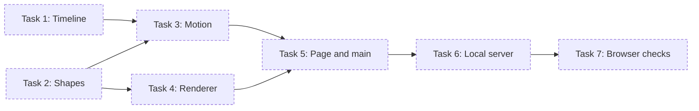

# Splash Page Implementation Plan

> **For agentic workers:** REQUIRED SUB-SKILL: Use superpowers:subagent-driven-development (recommended) or superpowers:executing-plans to implement this plan task-by-task. Steps use checkbox (`- [ ]`) syntax for tracking.

**Goal:** Build the phase-1 splash: about 240 points gather into an "N", hold, break apart and settle into a small line
chart that stays, in 3.5 s, with Skip, reduced motion, and nothing loaded from the network.

**Architecture:** Three pure ES modules (timeline, shapes, motion) compute every point's position at time `t`; a
renderer draws one frame on a canvas; `main.js` wires sizing, the animation loop, Skip, reduced motion and resize. A
zero-dependency `serve.mjs` serves the page locally, and `node --test` covers the pure modules, the renderer, the
server and a no-network scan.

**Tech Stack:** HTML, CSS, browser ES modules, Canvas 2D; Node 24 (`node:test`, `node:http`); no npm dependencies.

**Spec:** `.build/splash-test/documents/specs/phase-1/splash-design.md` (approved at gate `spec-phase-1`).



## Global Constraints

- Work on the existing branch `build/splash-test` in this checkout (`C:/work/nexus-test`). `.build/`
  lives here, so don't move execution into a separate worktree.
- Node 24.2 or later (the server uses `import.meta.main`). Installed: v24.18.0.
- No npm dependencies. `package.json` exists only to declare `"type": "module"` and `"private": true`.
- Accepted guardrails (paste `nexus guardrail list --accepted` into every dispatch brief):
  - The page loads nothing from the network at runtime: every script, font and asset ships with the page.
  - The whole animation finishes in under four seconds, and a visible Skip is available while it plays.
  - When the viewer prefers reduced motion, the page shows the end state straight away with no animation.
  - Canvas or SVG for the points, whether the chart animates in, and the colour palette are put to the user, not
    decided by Claude.
  - Phase 1 builds only the splash; the replay button and the second colour theme wait for a later phase.
- Timeline: gather 1300 ms, hold 600 ms, break 1200 ms, line 400 ms; `TOTAL` 3500.
- `POINT_COUNT` 240; scene seed `20261004`.
- Paper palette: `--bg #F6F3EC`, `--points #3A3A3A`, `--n-mark #1E1E1E`, `--chart-line #2F6FDB`, `--skip #5A5A5A`.
- Canvas label and fallback sentence: "A small line chart rising and falling across eight points".
- Server: `127.0.0.1`, port `PORT` or 8080.
- Commits are made as the repo's configured git user. Never push.

## Review Focus

1. **Mobile browser toolbars** change the viewport height mid-animation. The drawing must not stretch or crop.
   `main.js` sizes the canvas from its own `getBoundingClientRect()`, not from `innerHeight`, and Task 7 checks a resize
   mid-animation and at the end state.
2. **The first animation frame's timestamp can be earlier than `performance.now()` at start**, so `t` is negative. It
   must draw the start frame, not jump. Pinned by `frameAt(-16)` in Task 3.
3. **Author CSS can defeat the `hidden` attribute.** If `.skip` ever gets a `display` rule, Skip would flash under
   reduced motion. Task 5 adds `.skip[hidden] { display: none; }`, and Task 7 checks that Skip never appears under
   reduced motion.
4. **A zero-size viewport** (a collapsed iframe, or a background tab at load) must not produce NaN positions that
   poison later frames. Pinned by a 0×0 scene test in Task 3.
5. **A malformed percent-encoded URL** (`/%E0%A4%A`) must get 400, not crash the dev server, and encoded or backslash
   traversal (`/%2e%2e/`, `/..%5c`) must get 403. Pinned in Task 6.

Two small additions beyond the spec's test table, both pinned to the units above: `render.test.mjs` (Task 4) checks
colour mixing and what the renderer draws, and the no-network scan also rejects `XMLHttpRequest`, `WebSocket` and
`EventSource`.

---

### Task 1: Timeline

**Files:**
- Create: `package.json`
- Create: `src/timeline.js`
- Test: `test/timeline.test.mjs`

**Interfaces:**
- Consumes: nothing.
- Produces: `PHASES: { name: 'gather'|'hold'|'break'|'line', duration: number }[]`, `TOTAL: number` (3500),
  `phaseAt(t: number) => { phase: 'gather'|'hold'|'break'|'line'|'end', progress: number }`,
  `easeInOutCubic(x: number) => number`, `easeOutCubic(x: number) => number`.

- [ ] **Step 1: Declare the package as ES modules**

Create `package.json`:

```json
{
  "private": true,
  "type": "module"
}
```

- [ ] **Step 2: Write the failing test**

Create `test/timeline.test.mjs`:

```js
import test from 'node:test';
import assert from 'node:assert/strict';
import { PHASES, TOTAL, phaseAt, easeInOutCubic, easeOutCubic } from '../src/timeline.js';

test('the animation totals 3500 ms, under the four-second limit', () => {
  assert.equal(TOTAL, 3500);
  assert.ok(TOTAL < 4000);
  assert.deepEqual(PHASES.map((p) => p.name), ['gather', 'hold', 'break', 'line']);
  assert.deepEqual(PHASES.map((p) => p.duration), [1300, 600, 1200, 400]);
  assert.equal(PHASES.reduce((sum, p) => sum + p.duration, 0), TOTAL);
});

test('phaseAt starts in gather and treats negative time as 0', () => {
  assert.deepEqual(phaseAt(0), { phase: 'gather', progress: 0 });
  assert.deepEqual(phaseAt(-16), { phase: 'gather', progress: 0 });
});

test('a time on a boundary belongs to the later phase', () => {
  assert.deepEqual(phaseAt(1300), { phase: 'hold', progress: 0 });
  assert.deepEqual(phaseAt(1900), { phase: 'break', progress: 0 });
  assert.deepEqual(phaseAt(3100), { phase: 'line', progress: 0 });
});

test('progress is the raw fraction within the phase', () => {
  assert.deepEqual(phaseAt(650), { phase: 'gather', progress: 0.5 });
  assert.deepEqual(phaseAt(1600), { phase: 'hold', progress: 0.5 });
  assert.deepEqual(phaseAt(2500), { phase: 'break', progress: 0.5 });
  assert.deepEqual(phaseAt(3300), { phase: 'line', progress: 0.5 });
});

test('at and past the total, phaseAt returns end with progress 1', () => {
  for (const t of [3500, 3501, 10000, Infinity]) {
    assert.deepEqual(phaseAt(t), { phase: 'end', progress: 1 });
  }
});

test('both easings map 0 to 0 and 1 to 1', () => {
  for (const ease of [easeInOutCubic, easeOutCubic]) {
    assert.equal(ease(0), 0);
    assert.equal(ease(1), 1);
  }
  assert.equal(easeInOutCubic(0.5), 0.5);
  assert.ok(easeOutCubic(0.5) > 0.5);
});
```

- [ ] **Step 3: Run the test to verify it fails**

Run: `node --test test/timeline.test.mjs`
Expected: FAIL with `Cannot find module` for `src/timeline.js`.

- [ ] **Step 4: Write the implementation**

Create `src/timeline.js`:

```js
// The splash timeline: four phases, then the end state. Times are milliseconds from the start.

export const PHASES = [
  { name: 'gather', duration: 1300 },
  { name: 'hold', duration: 600 },
  { name: 'break', duration: 1200 },
  { name: 'line', duration: 400 },
];

export const TOTAL = PHASES.reduce((sum, phase) => sum + phase.duration, 0);

// The phase at time t and the raw 0–1 progress within it. A boundary belongs to the later phase.
export function phaseAt(t) {
  let time = Math.max(0, t);
  if (time >= TOTAL) return { phase: 'end', progress: 1 };
  for (const { name, duration } of PHASES) {
    if (time < duration) return { phase: name, progress: time / duration };
    time -= duration;
  }
  return { phase: 'end', progress: 1 };
}

export function easeInOutCubic(x) {
  return x < 0.5 ? 4 * x * x * x : 1 - (-2 * x + 2) ** 3 / 2;
}

export function easeOutCubic(x) {
  return 1 - (1 - x) ** 3;
}
```

- [ ] **Step 5: Run the test to verify it passes**

Run: `node --test test/timeline.test.mjs`
Expected: PASS, 6 tests, no "Reparsing as ES module" warning.

- [ ] **Step 6: Commit**

```bash
git add package.json src/timeline.js test/timeline.test.mjs
git commit -m "splash: add the animation timeline"
```

---

### Task 2: Shapes

**Files:**
- Create: `src/shapes.js`
- Test: `test/shapes.test.mjs`

**Interfaces:**
- Consumes: nothing.
- Produces (a point is `{ x: number, y: number }` in CSS pixels; a layout is
  `{ width, height, box: { x, y, size } }`):
  `POINT_COUNT` (240), `SEED` (20261004), `CHART_VALUES` (8 numbers),
  `mulberry32(seed) => () => number` (0 ≤ n < 1),
  `layoutFor(width, height) => layout`,
  `startPositions(count, layout, seed) => point[]`,
  `nTargets(count, layout, seed) => point[]`,
  `chartPath(layout) => point[]` (8 vertices),
  `chartTargets(count, layout) => point[]`,
  `polylineLength(vertices) => number`,
  `partialPath(vertices, s) => point[]` (the path from its start up to arc length `s`, ending exactly at `s`),
  `pointAlong(vertices, s) => point`.

- [ ] **Step 1: Write the failing test**

Create `test/shapes.test.mjs`:

```js
import test from 'node:test';
import assert from 'node:assert/strict';
import {
  POINT_COUNT, SEED, CHART_VALUES, mulberry32, layoutFor, startPositions, nTargets,
  chartPath, chartTargets, polylineLength, partialPath, pointAlong,
} from '../src/shapes.js';

const EPS = 1e-9;
const near = (a, b, eps = EPS) => Math.abs(a - b) <= eps;
const inside = (p, box) =>
  p.x >= box.x - EPS && p.x <= box.x + box.size + EPS && p.y >= box.y - EPS && p.y <= box.y + box.size + EPS;

function distanceToSegment(p, a, b) {
  const dx = b.x - a.x;
  const dy = b.y - a.y;
  const f = Math.max(0, Math.min(1, ((p.x - a.x) * dx + (p.y - a.y) * dy) / (dx * dx + dy * dy)));
  return Math.hypot(p.x - (a.x + dx * f), p.y - (a.y + dy * f));
}

const SIZES = [
  { label: 'phone', width: 390, height: 844, box: { x: 78, y: 305, size: 234 } },
  { label: 'desktop', width: 1440, height: 900, box: { x: 450, y: 180, size: 540 } },
];

test('constants match the spec', () => {
  assert.equal(POINT_COUNT, 240);
  assert.equal(SEED, 20261004);
  assert.deepEqual(CHART_VALUES, [0.35, 0.55, 0.45, 0.7, 0.6, 0.8, 0.65, 0.9]);
});

test('mulberry32 is repeatable and stays in [0, 1)', () => {
  const a = mulberry32(7);
  const b = mulberry32(7);
  for (let i = 0; i < 1000; i += 1) {
    const value = a();
    assert.equal(value, b());
    assert.ok(value >= 0 && value < 1);
  }
});

for (const { label, width, height, box } of SIZES) {
  const layout = layoutFor(width, height);

  test(`${label}: the box is 60% of the shorter side and centred`, () => {
    assert.equal(layout.width, width);
    assert.equal(layout.height, height);
    assert.ok(near(layout.box.size, box.size));
    assert.ok(near(layout.box.x, box.x));
    assert.ok(near(layout.box.y, box.y));
  });

  test(`${label}: starts cover the viewport and repeat for the same seed`, () => {
    const starts = startPositions(POINT_COUNT, layout, SEED);
    assert.equal(starts.length, 240);
    for (const p of starts) assert.ok(p.x >= 0 && p.x < width && p.y >= 0 && p.y < height);
    assert.deepEqual(startPositions(POINT_COUNT, layout, SEED), starts);
    assert.notDeepEqual(startPositions(POINT_COUNT, layout, SEED + 99), starts);
  });

  test(`${label}: N targets sit inside the box, on the three strokes`, () => {
    const targets = nTargets(POINT_COUNT, layout, SEED + 1);
    assert.equal(targets.length, 240);
    const at = (u, v) => ({ x: layout.box.x + u * layout.box.size, y: layout.box.y + v * layout.box.size });
    const strokes = [
      [at(0.22, 0.85), at(0.22, 0.15)],
      [at(0.22, 0.15), at(0.78, 0.85)],
      [at(0.78, 0.85), at(0.78, 0.15)],
    ];
    const tolerance = 0.02 * layout.box.size + 1e-6;
    for (const p of targets) {
      assert.ok(inside(p, layout.box), `N target outside the box: ${JSON.stringify(p)}`);
      const nearest = Math.min(...strokes.map(([a, b]) => distanceToSegment(p, a, b)));
      assert.ok(nearest <= tolerance, `N target off the strokes by ${nearest}`);
    }
  });

  test(`${label}: the chart path has 8 vertices across the full box width`, () => {
    const path = chartPath(layout);
    assert.equal(path.length, 8);
    assert.ok(near(path[0].x, layout.box.x));
    assert.ok(near(path[7].x, layout.box.x + layout.box.size));
    CHART_VALUES.forEach((value, i) => {
      assert.ok(near(path[i].y, layout.box.y + (0.75 - 0.5 * value) * layout.box.size));
    });
  });

  test(`${label}: chart targets run left to right from the first vertex to the last`, () => {
    const path = chartPath(layout);
    const targets = chartTargets(POINT_COUNT, layout);
    assert.equal(targets.length, 240);
    for (const p of targets) assert.ok(inside(p, layout.box));
    for (let i = 1; i < targets.length; i += 1) assert.ok(targets[i].x >= targets[i - 1].x - EPS);
    assert.ok(near(targets[0].x, path[0].x) && near(targets[0].y, path[0].y));
    assert.ok(near(targets[239].x, path[7].x, 1e-6) && near(targets[239].y, path[7].y, 1e-6));
  });
}

test('partialPath stops exactly at the requested arc length', () => {
  const path = [{ x: 0, y: 0 }, { x: 3, y: 4 }, { x: 3, y: 10 }];
  assert.equal(polylineLength(path), 11);
  assert.ok(near(polylineLength(partialPath(path, 5.5)), 5.5));
  const mid = pointAlong(path, 5.5);
  assert.ok(near(mid.x, 3) && near(mid.y, 4.5));
  assert.deepEqual(pointAlong(path, 0), { x: 0, y: 0 });
  assert.deepEqual(pointAlong(path, 11), { x: 3, y: 10 });
  assert.deepEqual(pointAlong(path, 50), { x: 3, y: 10 });
});
```

- [ ] **Step 2: Run the test to verify it fails**

Run: `node --test test/shapes.test.mjs`
Expected: FAIL with `Cannot find module` for `src/shapes.js`.

- [ ] **Step 3: Write the implementation**

Create `src/shapes.js`:

```js
// Pure geometry: where the points start, the N they gather into and the chart they settle on.
// Every coordinate is in CSS pixels.

export const POINT_COUNT = 240;
export const SEED = 20261004;
export const CHART_VALUES = [0.35, 0.55, 0.45, 0.7, 0.6, 0.8, 0.65, 0.9];

// The N's strokes in box units (0–1, y down): left stem, diagonal, right stem.
const N_STROKES = [
  [{ u: 0.22, v: 0.85 }, { u: 0.22, v: 0.15 }],
  [{ u: 0.22, v: 0.15 }, { u: 0.78, v: 0.85 }],
  [{ u: 0.78, v: 0.85 }, { u: 0.78, v: 0.15 }],
];
const N_THICKNESS = 0.02;

export function mulberry32(seed) {
  let a = seed >>> 0;
  return function next() {
    a = (a + 0x6d2b79f5) >>> 0;
    let t = a;
    t = Math.imul(t ^ (t >>> 15), t | 1);
    t ^= t + Math.imul(t ^ (t >>> 7), t | 61);
    return ((t ^ (t >>> 14)) >>> 0) / 4294967296;
  };
}

export function layoutFor(width, height) {
  const size = Math.min(width, height) * 0.6;
  return { width, height, box: { x: (width - size) / 2, y: (height - size) / 2, size } };
}

function inBox(layout, u, v) {
  const { x, y, size } = layout.box;
  return { x: x + u * size, y: y + v * size };
}

export function startPositions(count, layout, seed) {
  const random = mulberry32(seed);
  return Array.from({ length: count }, () => ({ x: random() * layout.width, y: random() * layout.height }));
}

// Points spread along the three strokes in proportion to their length, each nudged sideways for thickness.
export function nTargets(count, layout, seed) {
  const random = mulberry32(seed);
  const lengths = N_STROKES.map(([a, b]) => Math.hypot(b.u - a.u, b.v - a.v));
  const total = lengths.reduce((sum, l) => sum + l, 0);
  return Array.from({ length: count }, (_, i) => {
    let s = ((i + 0.5) / count) * total;
    let k = 0;
    while (k < N_STROKES.length - 1 && s > lengths[k]) {
      s -= lengths[k];
      k += 1;
    }
    const [a, b] = N_STROKES[k];
    const f = s / lengths[k];
    const normalU = -(b.v - a.v) / lengths[k];
    const normalV = (b.u - a.u) / lengths[k];
    const offset = (random() * 2 - 1) * N_THICKNESS;
    return inBox(layout, a.u + (b.u - a.u) * f + normalU * offset, a.v + (b.v - a.v) * f + normalV * offset);
  });
}

export function chartPath(layout) {
  const last = CHART_VALUES.length - 1;
  return CHART_VALUES.map((value, i) => inBox(layout, i / last, 0.75 - 0.5 * value));
}

// Points spaced evenly by arc length along the chart path, first on its first vertex and last on its last.
export function chartTargets(count, layout) {
  const path = chartPath(layout);
  const total = polylineLength(path);
  return Array.from({ length: count }, (_, i) => pointAlong(path, count === 1 ? 0 : (i / (count - 1)) * total));
}

export function polylineLength(vertices) {
  let total = 0;
  for (let i = 1; i < vertices.length; i += 1) {
    total += Math.hypot(vertices[i].x - vertices[i - 1].x, vertices[i].y - vertices[i - 1].y);
  }
  return total;
}

// The path from its start up to arc length s, ending on the exact point at s.
export function partialPath(vertices, s) {
  const out = [{ ...vertices[0] }];
  let remaining = Math.max(0, s);
  for (let i = 1; i < vertices.length; i += 1) {
    const a = vertices[i - 1];
    const b = vertices[i];
    const length = Math.hypot(b.x - a.x, b.y - a.y);
    if (remaining >= length) {
      out.push({ ...b });
      remaining -= length;
      continue;
    }
    const f = remaining / length;
    out.push({ x: a.x + (b.x - a.x) * f, y: a.y + (b.y - a.y) * f });
    return out;
  }
  return out;
}

export function pointAlong(vertices, s) {
  const path = partialPath(vertices, s);
  return path[path.length - 1];
}
```

- [ ] **Step 4: Run the test to verify it passes**

Run: `node --test test/shapes.test.mjs`
Expected: PASS, 13 tests.

- [ ] **Step 5: Commit**

```bash
git add src/shapes.js test/shapes.test.mjs
git commit -m "splash: add start, N and chart geometry"
```

---

### Task 3: Motion

**Files:**
- Create: `src/motion.js`
- Test: `test/motion.test.mjs`

**Interfaces:**
- Consumes: from `timeline.js`, `phaseAt`, `easeInOutCubic` and `easeOutCubic`; from `shapes.js`, `POINT_COUNT`,
  `SEED`, `mulberry32`, `layoutFor`, `startPositions`, `nTargets`, `chartTargets` and `chartPath`.
- Produces: `createScene(width, height) => scene`, where `scene` is
  `{ width, height, layout, path: point[], points: ScenePoint[] }` and each `ScenePoint` is
  `{ start, n, chart, delay, driftSign, shimmer, normal, control }`;
  `frameAt(t, scene) => { points: { x, y, alpha }[], ink: number, line: number }`.
  Scene seeds: starts `SEED`, N `SEED + 1`, per-point values `SEED + 2`.

- [ ] **Step 1: Write the failing test**

Create `test/motion.test.mjs`:

```js
import test from 'node:test';
import assert from 'node:assert/strict';
import { createScene, frameAt } from '../src/motion.js';
import { POINT_COUNT, SEED, startPositions, nTargets, chartTargets } from '../src/shapes.js';

const near = (a, b, eps = 1e-9) => Math.abs(a - b) <= eps;

function assertPositions(points, expected) {
  assert.equal(points.length, expected.length);
  points.forEach((p, i) => {
    assert.ok(near(p.x, expected[i].x) && near(p.y, expected[i].y), `point ${i}: ${JSON.stringify(p)} vs ${JSON.stringify(expected[i])}`);
  });
}

const scene = createScene(390, 844);
const starts = startPositions(POINT_COUNT, scene.layout, SEED);
const nMark = nTargets(POINT_COUNT, scene.layout, SEED + 1);
const chart = chartTargets(POINT_COUNT, scene.layout);

test('the scene is the same every time for the same size', () => {
  assert.deepEqual(createScene(390, 844), scene);
  assert.equal(scene.points.length, 240);
  assert.equal(scene.path.length, 8);
});

test('frameAt(0) is the start positions, with no ink and no line', () => {
  const frame = frameAt(0, scene);
  assertPositions(frame.points, starts);
  assert.equal(frame.ink, 0);
  assert.equal(frame.line, 0);
});

test('a frame timestamp slightly before the start draws the start frame', () => {
  assert.deepEqual(frameAt(-16, scene), frameAt(0, scene));
});

test('frameAt(1300) is the N, fully inked', () => {
  const frame = frameAt(1300, scene);
  assertPositions(frame.points, nMark);
  assert.equal(frame.ink, 1);
  assert.equal(frame.line, 0);
});

test('the hold shimmers in opacity only', () => {
  const frame = frameAt(1600, scene);
  assertPositions(frame.points, nMark);
  for (const p of frame.points) assert.ok(p.alpha >= 0.75 - 1e-9 && p.alpha <= 1 + 1e-9);
  assert.ok(frame.points.some((p) => p.alpha < 0.99));
});

test('the end state is the chart with the line drawn, at 3500 ms and any time after', () => {
  for (const t of [3500, 10000]) {
    const frame = frameAt(t, scene);
    assertPositions(frame.points, chart);
    assert.equal(frame.ink, 0);
    assert.equal(frame.line, 1);
    for (const p of frame.points) assert.equal(p.alpha, 1);
  }
});

test('the line stays undrawn until 3100 ms, then draws in', () => {
  for (const t of [0, 1300, 2000, 3099]) assert.equal(frameAt(t, scene).line, 0);
  const mid = frameAt(3300, scene).line;
  assert.ok(mid > 0 && mid < 1);
});

test('ink falls from 1 to 0 across the break', () => {
  assert.equal(frameAt(1900, scene).ink, 1);
  const mid = frameAt(2500, scene).ink;
  assert.ok(mid > 0 && mid < 1);
  assert.equal(frameAt(3100, scene).ink, 0);
});

test('a zero-size viewport gives finite positions at every time', () => {
  const empty = createScene(0, 0);
  for (let t = 0; t <= 3500; t += 50) {
    for (const p of frameAt(t, empty).points) {
      assert.ok(Number.isFinite(p.x) && Number.isFinite(p.y) && Number.isFinite(p.alpha), `t=${t}`);
    }
  }
});
```

- [ ] **Step 2: Run the test to verify it fails**

Run: `node --test test/motion.test.mjs`
Expected: FAIL with `Cannot find module` for `src/motion.js`.

- [ ] **Step 3: Write the implementation**

Create `src/motion.js`:

```js
// Where every point is at time t. createScene fixes all targets and per-point random values for one viewport
// size; frameAt only reads them.

import { phaseAt, easeInOutCubic, easeOutCubic } from './timeline.js';
import {
  POINT_COUNT, SEED, mulberry32, layoutFor, startPositions, nTargets, chartTargets, chartPath,
} from './shapes.js';

const DRIFT_PX = 12;
const MAX_DELAY = 0.25;
const BURST = 0.25;

const clamp01 = (x) => Math.min(1, Math.max(0, x));

export function createScene(width, height) {
  const layout = layoutFor(width, height);
  const starts = startPositions(POINT_COUNT, layout, SEED);
  const nMark = nTargets(POINT_COUNT, layout, SEED + 1);
  const chart = chartTargets(POINT_COUNT, layout);
  const random = mulberry32(SEED + 2);
  const { x, y, size } = layout.box;
  const centre = { x: x + size / 2, y: y + size / 2 };

  const points = starts.map((start, i) => {
    const n = nMark[i];
    const travelX = n.x - start.x;
    const travelY = n.y - start.y;
    const travel = Math.hypot(travelX, travelY) || 1;
    const outX = n.x - centre.x;
    const outY = n.y - centre.y;
    const out = Math.hypot(outX, outY) || 1;
    return {
      start,
      n,
      chart: chart[i],
      delay: random() * MAX_DELAY,
      driftSign: random() < 0.5 ? -1 : 1,
      shimmer: random(),
      normal: { x: -travelY / travel, y: travelX / travel },
      control: { x: n.x + (outX / out) * BURST * size, y: n.y + (outY / out) * BURST * size },
    };
  });

  return { width, height, layout, path: chartPath(layout), points };
}

export function frameAt(t, scene) {
  const { phase, progress: p } = phaseAt(t);

  if (phase === 'gather') {
    const points = scene.points.map((pt) => {
      const e = easeInOutCubic(clamp01((p - pt.delay) / (1 - MAX_DELAY)));
      const drift = DRIFT_PX * Math.sin(Math.PI * e) * pt.driftSign;
      return {
        x: pt.start.x + (pt.n.x - pt.start.x) * e + pt.normal.x * drift,
        y: pt.start.y + (pt.n.y - pt.start.y) * e + pt.normal.y * drift,
        alpha: 1,
      };
    });
    return { points, ink: p, line: 0 };
  }

  if (phase === 'hold') {
    const points = scene.points.map((pt) => ({
      x: pt.n.x,
      y: pt.n.y,
      alpha: 0.875 + 0.125 * Math.sin(2 * Math.PI * (p + pt.shimmer)),
    }));
    return { points, ink: 1, line: 0 };
  }

  if (phase === 'break') {
    const e = easeInOutCubic(p);
    const a = (1 - e) * (1 - e);
    const b = 2 * (1 - e) * e;
    const c = e * e;
    const points = scene.points.map((pt) => ({
      x: a * pt.n.x + b * pt.control.x + c * pt.chart.x,
      y: a * pt.n.y + b * pt.control.y + c * pt.chart.y,
      alpha: 1,
    }));
    return { points, ink: 1 - e, line: 0 };
  }

  const points = scene.points.map((pt) => ({ x: pt.chart.x, y: pt.chart.y, alpha: 1 }));
  return { points, ink: 0, line: phase === 'line' ? easeOutCubic(p) : 1 };
}
```

- [ ] **Step 4: Run the test to verify it passes**

Run: `node --test test/motion.test.mjs`
Expected: PASS, 9 tests.

- [ ] **Step 5: Commit**

```bash
git add src/motion.js test/motion.test.mjs
git commit -m "splash: add frame-at-time motion"
```

---

### Task 4: Renderer

**Files:**
- Create: `src/render.js`
- Test: `test/render.test.mjs`

**Interfaces:**
- Consumes: from `shapes.js`, `polylineLength` and `partialPath`. It reads a `scene` (`width`, `height`, `path`) and a
  frame from `motion.js`, shaped as in Task 3.
- Produces: `drawFrame(ctx, frame, scene, palette) => void`, where `palette` is
  `{ bg, points, nMark, chartLine }` (hex strings like `#3A3A3A`, surrounding whitespace allowed);
  `mixHex(from, to, k) => 'rgb(r, g, b)'`, with `k` clamped to 0–1.

- [ ] **Step 1: Write the failing test**

Create `test/render.test.mjs`:

```js
import test from 'node:test';
import assert from 'node:assert/strict';
import { drawFrame, mixHex } from '../src/render.js';
import { createScene, frameAt } from '../src/motion.js';

const PALETTE = { bg: '#F6F3EC', points: '#3A3A3A', nMark: '#1E1E1E', chartLine: '#2F6FDB' };

function recorder() {
  const calls = [];
  const ctx = { calls };
  for (const name of ['fillRect', 'beginPath', 'arc', 'fill', 'moveTo', 'lineTo', 'stroke']) {
    ctx[name] = (...args) => calls.push([name, ...args]);
  }
  return ctx;
}

const count = (ctx, name) => ctx.calls.filter(([n]) => n === name).length;

test('mixHex blends two colours and clamps k', () => {
  assert.equal(mixHex('#3A3A3A', '#1E1E1E', 0), 'rgb(58, 58, 58)');
  assert.equal(mixHex('#3A3A3A', '#1E1E1E', 1), 'rgb(30, 30, 30)');
  assert.equal(mixHex('#3A3A3A', '#1E1E1E', 0.5), 'rgb(44, 44, 44)');
  assert.equal(mixHex(' #3a3a3a', '#1e1e1e ', 2), 'rgb(30, 30, 30)');
});

const scene = createScene(390, 844);

test('a mid-gather frame clears the canvas and draws every point, with no line', () => {
  const ctx = recorder();
  drawFrame(ctx, frameAt(600, scene), scene, PALETTE);
  assert.deepEqual(ctx.calls[0], ['fillRect', 0, 0, 390, 844]);
  assert.equal(count(ctx, 'arc'), 240);
  assert.equal(count(ctx, 'stroke'), 0);
  assert.equal(ctx.globalAlpha, 1);
});

test('the N is drawn in the N colour', () => {
  const ctx = recorder();
  drawFrame(ctx, frameAt(1300, scene), scene, PALETTE);
  assert.equal(ctx.fillStyle, 'rgb(30, 30, 30)');
});

test('the end state draws the points and strokes the whole chart line in the line colour', () => {
  const ctx = recorder();
  drawFrame(ctx, frameAt(3500, scene), scene, PALETTE);
  assert.equal(count(ctx, 'arc'), 240);
  assert.equal(count(ctx, 'stroke'), 1);
  assert.equal(count(ctx, 'lineTo'), 7);
  assert.equal(ctx.strokeStyle, '#2F6FDB');
  assert.equal(ctx.lineWidth, 2.5);
  assert.equal(ctx.fillStyle, 'rgb(58, 58, 58)');
});
```

- [ ] **Step 2: Run the test to verify it fails**

Run: `node --test test/render.test.mjs`
Expected: FAIL with `Cannot find module` for `src/render.js`.

- [ ] **Step 3: Write the implementation**

Create `src/render.js`:

```js
// Draws one frame on a 2D context in CSS pixels. The palette comes in as colour strings; nothing here reads the DOM.

import { polylineLength, partialPath } from './shapes.js';

const POINT_RADIUS = 1.6;
const LINE_WIDTH = 2.5;

function parseHex(hex) {
  const digits = hex.trim().replace('#', '');
  return [0, 2, 4].map((i) => parseInt(digits.slice(i, i + 2), 16));
}

export function mixHex(from, to, k) {
  const a = parseHex(from);
  const b = parseHex(to);
  const f = Math.min(1, Math.max(0, k));
  const [r, g, bl] = a.map((value, i) => Math.round(value + (b[i] - value) * f));
  return `rgb(${r}, ${g}, ${bl})`;
}

export function drawFrame(ctx, frame, scene, palette) {
  ctx.globalAlpha = 1;
  ctx.fillStyle = palette.bg;
  ctx.fillRect(0, 0, scene.width, scene.height);

  ctx.fillStyle = mixHex(palette.points, palette.nMark, frame.ink);
  for (const point of frame.points) {
    ctx.globalAlpha = point.alpha;
    ctx.beginPath();
    ctx.arc(point.x, point.y, POINT_RADIUS, 0, Math.PI * 2);
    ctx.fill();
  }
  ctx.globalAlpha = 1;

  if (frame.line <= 0) return;
  const path = partialPath(scene.path, frame.line * polylineLength(scene.path));
  ctx.strokeStyle = palette.chartLine;
  ctx.lineWidth = LINE_WIDTH;
  ctx.lineJoin = 'round';
  ctx.lineCap = 'round';
  ctx.beginPath();
  ctx.moveTo(path[0].x, path[0].y);
  for (const vertex of path.slice(1)) ctx.lineTo(vertex.x, vertex.y);
  ctx.stroke();
}
```

- [ ] **Step 4: Run the test to verify it passes**

Run: `node --test test/render.test.mjs`
Expected: PASS, 4 tests.

- [ ] **Step 5: Commit**

```bash
git add src/render.js test/render.test.mjs
git commit -m "splash: add the canvas renderer"
```

---

### Task 5: Page and main

**Files:**
- Create: `index.html`
- Create: `styles.css`
- Create: `src/main.js`
- Test: `test/no-network.test.mjs`

**Interfaces:**
- Consumes: `TOTAL` from `timeline.js`; `createScene` and `frameAt` from `motion.js`; `drawFrame` from `render.js`.
- Produces: `play()` and `showEnd()` exported from `src/main.js` (phase 2's Replay will call `play()`); the page
  structure: one `<canvas>`, one `button.skip`.

- [ ] **Step 1: Write the failing test**

Create `test/no-network.test.mjs`:

```js
import test from 'node:test';
import assert from 'node:assert/strict';
import { readFile, readdir } from 'node:fs/promises';
import { dirname, join } from 'node:path';
import { fileURLToPath } from 'node:url';

const ROOT = join(dirname(fileURLToPath(import.meta.url)), '..');

const FORBIDDEN = [
  ['an http or https URL', /https?:\/\//i],
  ['a protocol-relative src or href', /\b(?:src|href)\s*=\s*["']?\/\//i],
  ['fetch(', /\bfetch\s*\(/],
  ['@import url(', /@import\s+url\(/i],
  ['XMLHttpRequest, WebSocket or EventSource', /\b(?:XMLHttpRequest|WebSocket|EventSource)\b/],
];

async function shippedFiles() {
  const entries = await readdir(join(ROOT, 'src'), { recursive: true, withFileTypes: true });
  const sources = entries.filter((e) => e.isFile()).map((e) => join(e.parentPath, e.name));
  return [join(ROOT, 'index.html'), join(ROOT, 'styles.css'), ...sources];
}

test('the shipped files reference nothing on the network', async () => {
  const files = await shippedFiles();
  assert.ok(files.length >= 7, `expected index.html, styles.css and 5 modules, found ${files.length} files`);
  for (const file of files) {
    const text = await readFile(file, 'utf8');
    for (const [label, pattern] of FORBIDDEN) assert.doesNotMatch(text, pattern, `${file} contains ${label}`);
  }
});
```

- [ ] **Step 2: Run the test to verify it fails**

Run: `node --test test/no-network.test.mjs`
Expected: FAIL with `ENOENT` for `index.html`.

- [ ] **Step 3: Write the page**

Create `index.html`:

```html
<!doctype html>
<html lang="en">
<head>
  <meta charset="utf-8">
  <meta name="viewport" content="width=device-width, initial-scale=1">
  <title>splash-test</title>
  <link rel="icon" href="data:,">
  <link rel="stylesheet" href="styles.css">
</head>
<body>
  <canvas role="img" aria-label="A small line chart rising and falling across eight points">A small line chart rising and falling across eight points.</canvas>
  <button type="button" class="skip" hidden>Skip</button>
  <script type="module" src="src/main.js"></script>
</body>
</html>
```

Create `styles.css`:

```css
:root {
  --bg: #F6F3EC;
  --points: #3A3A3A;
  --n-mark: #1E1E1E;
  --chart-line: #2F6FDB;
  --skip: #5A5A5A;
}

html,
body {
  margin: 0;
  height: 100%;
  overflow: hidden;
  background: var(--bg);
}

canvas {
  position: fixed;
  inset: 0;
  display: block;
  width: 100%;
  height: 100%;
}

.skip {
  position: fixed;
  right: 16px;
  bottom: 16px;
  min-height: 44px;
  padding: 0 18px;
  font: 15px/1 system-ui, -apple-system, "Segoe UI", Roboto, sans-serif;
  color: var(--skip);
  background: transparent;
  border: 1px solid var(--skip);
  border-radius: 4px;
  cursor: pointer;
}

.skip[hidden] {
  display: none;
}

.skip:focus-visible {
  outline: 2px solid var(--chart-line);
  outline-offset: 2px;
}

.fallback {
  margin: 0;
  padding: 16px;
  font: 16px/1.4 system-ui, -apple-system, "Segoe UI", Roboto, sans-serif;
  color: var(--points);
}
```

- [ ] **Step 4: Write main**

Create `src/main.js`:

```js
// Wires the splash into the page: canvas sizing, the animation loop, Skip, reduced motion, resize and the fallback.

import { TOTAL } from './timeline.js';
import { createScene, frameAt } from './motion.js';
import { drawFrame } from './render.js';

const MAX_DPR = 2;

const canvas = document.querySelector('canvas');
const skip = document.querySelector('.skip');
const ctx = canvas.getContext('2d');

let scene = null;
let palette = null;
let frameId = 0;
let startTime = 0;
let ended = false;

function readPalette() {
  const style = getComputedStyle(document.documentElement);
  const value = (name) => style.getPropertyValue(name).trim();
  return { bg: value('--bg'), points: value('--points'), nMark: value('--n-mark'), chartLine: value('--chart-line') };
}

// Sized from the canvas's own box, so mobile toolbars showing or hiding never stretch the drawing.
function fitCanvas() {
  const { width, height } = canvas.getBoundingClientRect();
  const dpr = Math.min(window.devicePixelRatio || 1, MAX_DPR);
  canvas.width = Math.round(width * dpr);
  canvas.height = Math.round(height * dpr);
  ctx.setTransform(dpr, 0, 0, dpr, 0, 0);
  scene = createScene(width, height);
}

function draw(t) {
  drawFrame(ctx, frameAt(t, scene), scene, palette);
}

function tick(now) {
  const t = now - startTime;
  if (t >= TOTAL) {
    showEnd();
    return;
  }
  draw(t);
  frameId = requestAnimationFrame(tick);
}

export function play() {
  ended = false;
  fitCanvas();
  startTime = performance.now();
  skip.hidden = false;
  frameId = requestAnimationFrame(tick);
}

export function showEnd() {
  cancelAnimationFrame(frameId);
  frameId = 0;
  ended = true;
  skip.remove();
  if (!scene) fitCanvas();
  draw(TOTAL);
}

function showFallback() {
  const text = document.createElement('p');
  text.className = 'fallback';
  text.textContent = canvas.textContent.trim();
  canvas.replaceWith(text);
  skip.remove();
}

if (!ctx) {
  showFallback();
} else {
  palette = readPalette();
  skip.addEventListener('click', showEnd);
  window.addEventListener('resize', () => {
    fitCanvas();
    if (ended) draw(TOTAL);
  });
  if (window.matchMedia('(prefers-reduced-motion: reduce)').matches) showEnd();
  else play();
}
```

- [ ] **Step 5: Run the tests to verify they pass**

Run: `node --test`
Expected: PASS, every test in `timeline`, `shapes`, `motion`, `render` and `no-network`.

Run: `node --check src/main.js`
Expected: no output (the syntax is valid).

- [ ] **Step 6: Commit**

```bash
git add index.html styles.css src/main.js test/no-network.test.mjs
git commit -m "splash: add the page, styles and main wiring"
```

---

### Task 6: Local server

**Files:**
- Create: `serve.mjs`
- Test: `test/serve.test.mjs`

**Interfaces:**
- Consumes: the repo files from Tasks 1–5 (the test requests `/` and `/src/main.js`).
- Produces: `createStaticServer(root?: string) => http.Server` exported from `serve.mjs`; running `node serve.mjs`
  listens on `127.0.0.1:${PORT || 8080}` and prints the URL.

- [ ] **Step 1: Write the failing test**

Create `test/serve.test.mjs`:

```js
import test, { before, after } from 'node:test';
import assert from 'node:assert/strict';
import { request } from 'node:http';
import { createStaticServer } from '../serve.mjs';

let server;
let port;

before(async () => {
  server = createStaticServer();
  await new Promise((resolve) => server.listen(0, '127.0.0.1', resolve));
  port = server.address().port;
});

after(() => new Promise((resolve) => server.close(resolve)));

// node:http sends the path exactly as given, so traversal attempts reach the server unnormalised.
function get(path, method = 'GET') {
  return new Promise((resolve, reject) => {
    const req = request({ host: '127.0.0.1', port, path, method }, (res) => {
      let body = '';
      res.setEncoding('utf8');
      res.on('data', (chunk) => { body += chunk; });
      res.on('end', () => resolve({ status: res.statusCode, type: res.headers['content-type'] ?? '', body }));
    });
    req.on('error', reject);
    req.end();
  });
}

test('/ serves the page as HTML', async () => {
  const res = await get('/');
  assert.equal(res.status, 200);
  assert.match(res.type, /^text\/html/);
  assert.match(res.body, /<canvas/);
});

test('modules are served as JavaScript', async () => {
  const res = await get('/src/main.js');
  assert.equal(res.status, 200);
  assert.match(res.type, /^text\/javascript/);
});

test('stylesheets are served as CSS', async () => {
  const res = await get('/styles.css');
  assert.equal(res.status, 200);
  assert.match(res.type, /^text\/css/);
});

test('paths that climb out of the root are refused', async () => {
  for (const path of ['/../secret.txt', '/%2e%2e/secret.txt', '/src/../../secret.txt']) {
    assert.equal((await get(path)).status, 403, path);
  }
  // A backslash is a separator on Windows (403) and an ordinary filename character elsewhere (404); never 200.
  assert.ok([403, 404].includes((await get('/..%5csecret.txt')).status));
});

test('a missing file gets 404', async () => {
  assert.equal((await get('/nope.js')).status, 404);
});

test('a malformed percent-encoding gets 400 and the server keeps serving', async () => {
  assert.equal((await get('/%E0%A4%A')).status, 400);
  assert.equal((await get('/')).status, 200);
});

test('only GET and HEAD are allowed', async () => {
  assert.equal((await get('/', 'POST')).status, 405);
  const head = await get('/', 'HEAD');
  assert.equal(head.status, 200);
  assert.equal(head.body, '');
});
```

- [ ] **Step 2: Run the test to verify it fails**

Run: `node --test test/serve.test.mjs`
Expected: FAIL with `Cannot find module` for `serve.mjs`.

- [ ] **Step 3: Write the implementation**

Create `serve.mjs`:

```js
// A zero-dependency static server for local development: node serve.mjs, then open the printed URL.

import { createServer } from 'node:http';
import { readFile } from 'node:fs/promises';
import { dirname, extname, resolve, sep } from 'node:path';
import { fileURLToPath } from 'node:url';

const ROOT = dirname(fileURLToPath(import.meta.url));

const TYPES = {
  '.html': 'text/html; charset=utf-8',
  '.js': 'text/javascript; charset=utf-8',
  '.mjs': 'text/javascript; charset=utf-8',
  '.css': 'text/css; charset=utf-8',
  '.svg': 'image/svg+xml',
  '.json': 'application/json; charset=utf-8',
  '.ico': 'image/x-icon',
};

function send(res, status, text, headers = {}) {
  res.writeHead(status, { 'Content-Type': 'text/plain; charset=utf-8', ...headers });
  res.end(text);
}

export function createStaticServer(root = ROOT) {
  const base = resolve(root);
  return createServer(async (req, res) => {
    if (req.method !== 'GET' && req.method !== 'HEAD') {
      send(res, 405, 'Method not allowed', { Allow: 'GET, HEAD' });
      return;
    }
    let path;
    try {
      path = decodeURIComponent(req.url.split('?')[0]);
    } catch {
      send(res, 400, 'Bad request');
      return;
    }
    if (path === '/') path = '/index.html';
    const file = resolve(base, `.${path}`);
    if (!file.startsWith(base + sep)) {
      send(res, 403, 'Forbidden');
      return;
    }
    try {
      const body = await readFile(file);
      res.writeHead(200, {
        'Content-Type': TYPES[extname(file)] ?? 'application/octet-stream',
        'Content-Length': body.length,
      });
      res.end(req.method === 'HEAD' ? undefined : body);
    } catch {
      send(res, 404, 'Not found');
    }
  });
}

if (import.meta.main) {
  const port = Number(process.env.PORT) || 8080;
  createStaticServer().listen(port, '127.0.0.1', () => {
    console.log(`splash-test: http://127.0.0.1:${port}/`);
  });
}
```

- [ ] **Step 4: Run the test to verify it passes**

Run: `node --test test/serve.test.mjs`
Expected: PASS, 7 tests.

- [ ] **Step 5: Run the full suite**

Run: `node --test`
Expected: PASS, all six test files, 0 failures.

- [ ] **Step 6: Commit**

```bash
git add serve.mjs test/serve.test.mjs
git commit -m "splash: add the local dev server"
```

---

### Task 7: Browser checks

**Files:**
- Create: `.build/splash-test/documents/reports/phase-1/browser-checks.md`
- Scratch: `.build/splash-test/files/browser-checks/` (screenshots)

**Interfaces:**
- Consumes: the page served by `node serve.mjs`.
- Produces: the report the finish gate relies on.

- [ ] **Step 1: Start the server**

Run in the background: `node serve.mjs`
Expected: prints `splash-test: http://127.0.0.1:8080/`.

- [ ] **Step 2: Phone and desktop**

With the browser tool (Playwright MCP `browser_run_code_unsafe`, one script per size so tool latency doesn't skew
timing), for 390×844 and then 1440×900. Screenshot paths are relative to the repo root; make them absolute if the
tool runs elsewhere:

```js
async (page) => {
  await page.setViewportSize({ width: 390, height: 844 });
  const requests = [];
  page.on('request', (r) => requests.push(r.url()));
  await page.goto('http://127.0.0.1:8080/');
  await page.waitForTimeout(1500);
  await page.screenshot({ path: '.build/splash-test/files/browser-checks/phone-hold.png' });
  const endedAt = await page.evaluate(() => new Promise((done) => {
    const id = setInterval(() => {
      if (!document.querySelector('.skip')) { clearInterval(id); done(performance.now()); }
    }, 20);
  }));
  await page.waitForTimeout(200);
  await page.screenshot({ path: '.build/splash-test/files/browser-checks/phone-end.png' });
  await page.setViewportSize({ width: 844, height: 390 });
  await page.waitForTimeout(200);
  await page.screenshot({ path: '.build/splash-test/files/browser-checks/phone-end-rotated.png' });
  return { endedAt, requests };
}
```

Pass when:
- the hold screenshot shows the N, centred and unstretched;
- the end screenshot shows the dotted chart with the blue line, centred;
- the rotated screenshot shows the chart redrawn to fit the new size;
- `endedAt` (milliseconds since navigation start) is under 4000;
- every URL in `requests` starts with `http://127.0.0.1:8080/`.

Repeat at 1440×900 (rotate to 900×1440), naming the files `desktop-*`.

- [ ] **Step 3: Resize mid-animation**

In one script at 390×844: go to the page, wait 1000 ms, set the viewport to 390×700 (a mobile toolbar appearing),
wait 200 ms, screenshot `resize-mid.png`, then wait for the end and screenshot `resize-end.png`.
Pass when both show undistorted shapes fitted to 390×700.

- [ ] **Step 4: Skip mid-animation**

In one script: go to the page, wait 800 ms, click `button.skip`, then return
`{ skipGone: !document.querySelector('.skip') }` and screenshot `skip.png` 100 ms later.
Pass when `skipGone` is true and the screenshot shows the full end state (chart and complete line).

Also check that Skip is reachable by keyboard: go to the page, press Tab once, screenshot `skip-focus.png`.
Pass when Skip shows the blue focus outline.

- [ ] **Step 5: Reduced motion**

In one script: `await page.emulateMedia({ reducedMotion: 'reduce' })`, go to the page, then immediately evaluate
`{ skip: !!document.querySelector('.skip') }` and screenshot `reduced.png`.
Pass when `skip` is false and the screenshot already shows the full end state.

- [ ] **Step 6: Write the report**

Create `.build/splash-test/documents/reports/phase-1/browser-checks.md`. Open with a results table, then a short
note per failure, if any:

```markdown
# Browser checks (phase 1)

| Check | Size | Result | Evidence |
|---|---|---|---|
| N at hold, centred and unstretched | 390×844 | pass/fail | files/browser-checks/phone-hold.png |
| End state | 390×844 | pass/fail | files/browser-checks/phone-end.png |
| Rotate after the end redraws | 844×390 | pass/fail | files/browser-checks/phone-end-rotated.png |
| N at hold, centred and unstretched | 1440×900 | pass/fail | files/browser-checks/desktop-hold.png |
| End state | 1440×900 | pass/fail | files/browser-checks/desktop-end.png |
| Rotate after the end redraws | 900×1440 | pass/fail | files/browser-checks/desktop-end-rotated.png |
| Resize mid-animation | 390×700 | pass/fail | files/browser-checks/resize-mid.png, resize-end.png |
| Skip mid-animation lands on the end state | 390×844 | pass/fail | files/browser-checks/skip.png |
| Skip reachable by keyboard with a visible focus ring | 390×844 | pass/fail | files/browser-checks/skip-focus.png |
| Reduced motion: end state at once, no Skip | 390×844 | pass/fail | files/browser-checks/reduced.png |
| Ends before 4 s | both | <endedAt values> ms | script output |
| Only localhost requests | both | pass/fail | <request count> requests |
```

Fill in every row from the runs above; don't leave pass/fail placeholders.

- [ ] **Step 7: Stop the server, run the full suite and commit**

Stop the background server.

Run: `node --test`
Expected: PASS, 0 failures.

```bash
git add .build/splash-test/documents/reports/phase-1/browser-checks.md .build/splash-test/files/browser-checks
git commit -m "splash: record phase-1 browser checks"
```

After this task, don't invoke `superpowers:finishing-a-development-branch`. The full suite above is the hand-back to
`/nexus:plan` step 5 (the finish gate).
